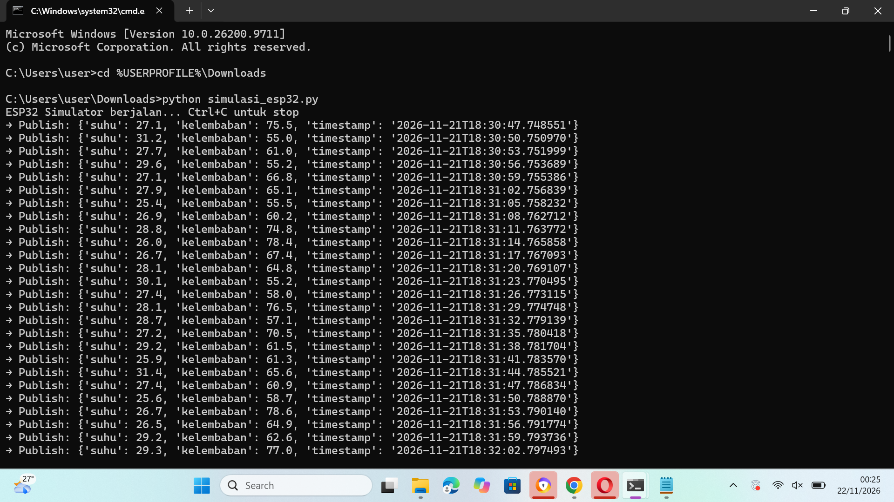
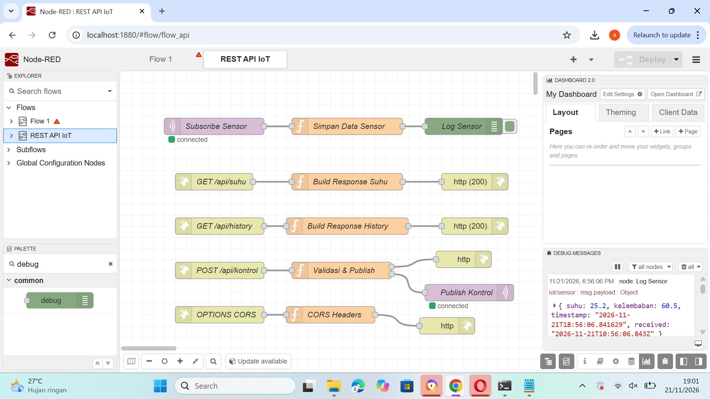
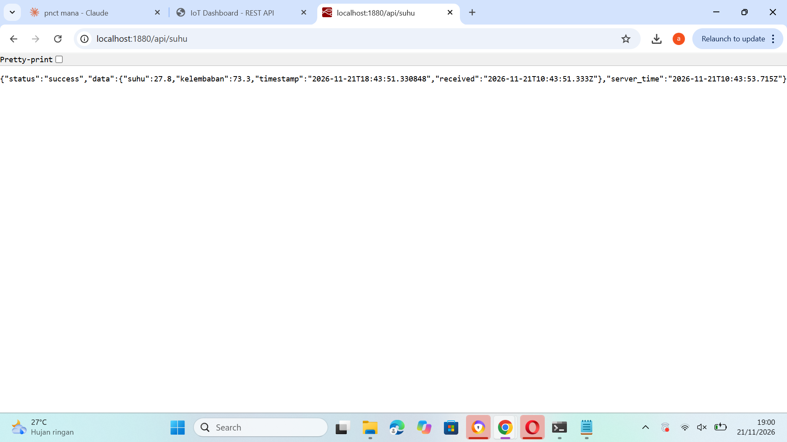
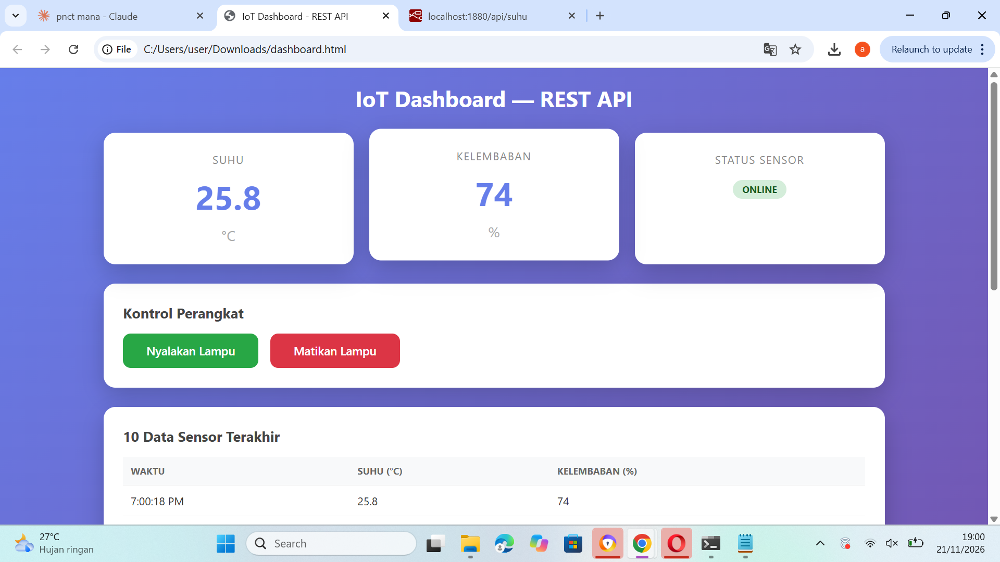
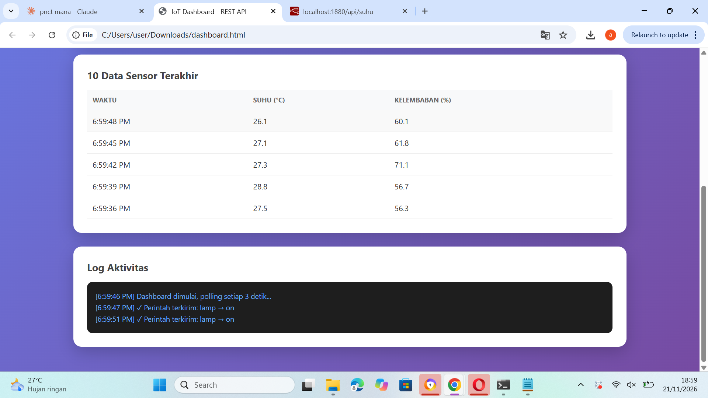
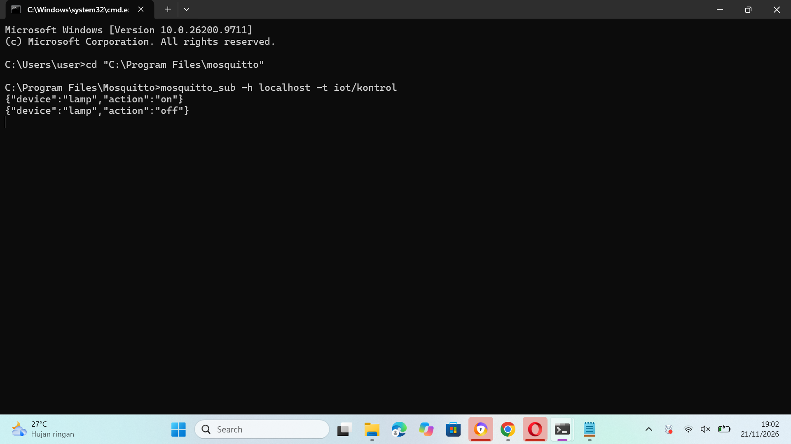

# Praktikum IoT: REST API Node-RED

**Nama:** Nabila Adhelia
**NPM:** 2410010105
**Mata Kuliah:** Pemrograman Internet of Things

## Deskripsi
Sistem monitoring dan kontrol IoT dengan alur:
ESP32 (simulator Python) -> MQTT (Mosquitto) -> Node-RED (REST API) -> Dashboard web (HTML/JS).

## File
| File | Fungsi |
|---|---|
| `simulasi_esp32.py` | Simulator ESP32, mengirim suhu dan kelembaban ke topik `iot/sensor` tiap 3 detik |
| `flow.json` | Flow Node-RED (backend REST API), diimpor lewat menu Import |
| `dashboard.html` | Dashboard web yang mengambil data lewat REST API |

## Endpoint
| Endpoint | Method | Fungsi |
|---|---|---|
| `/api/suhu` | GET | Data sensor terakhir |
| `/api/history` | GET | 50 data sensor terakhir |
| `/api/kontrol` | POST | Kirim perintah lampu ke topik `iot/kontrol` |

## Cara Menjalankan
1. Pastikan Mosquitto berjalan (service).
2. Jalankan Node-RED: `node-red`, buka `http://localhost:1880`.
3. Menu **Import**, pilih `flow.json`, lalu **Deploy**.
4. Aktifkan CORS di `settings.js` (hapus tanda `//` pada `httpNodeCors`), lalu restart Node-RED. Langkah ini diperlukan karena node OPTIONS pada Node-RED versi baru tidak mendukung wildcard.
5. Instal dependensi dan jalankan simulator:
   ```
   pip install paho-mqtt
   python simulasi_esp32.py
   ```
6. Buka `dashboard.html` di browser.

## Hasil Pengujian

### 1. Simulator ESP32


### 2. Flow Node-RED (status connected)


### 3. Endpoint /api/suhu


### 4. Dashboard (bagian atas)


### 5. Dashboard (tabel history dan log)


### 6. Bukti pesan MQTT pada topik iot/kontrol

